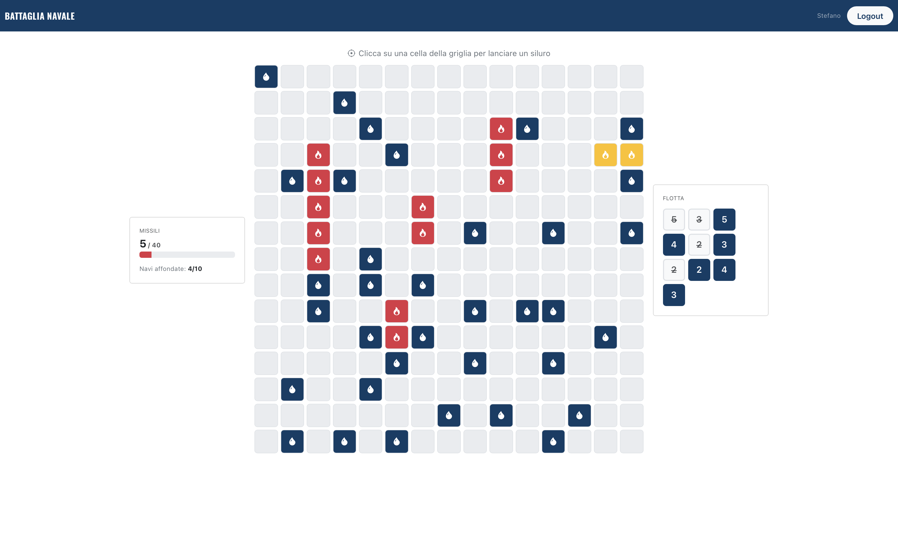

# Battaglia Navale

A full-stack Battleship web game. Guests can play quick games right away; registered players can create tournaments in which everyone hunts the same hidden fleet.



## Features

- **Casual games for guests** at three difficulty levels:

  | Difficulty | Grid | Ships | Missiles |
  | --- | --- | --- | --- |
  | Easy | 8 × 8 | 4 | 20 |
  | Medium | 10 × 10 | 6 | 30 |
  | Hard | 15 × 15 | 10 | 40 |

- **Tournaments** for registered players: create one at a chosen difficulty, share its join code, and every player who joins gets the same fleet layout.
- **No cheating from the browser**: ship positions stay on the server until the game is over.
- **Leaderboard** with games played, won, lost and win rate for each difficulty.
- **Authentication** with cookie-based sessions (Passport and express-session) and salted password hashing; every endpoint validates its input.

## Tech stack

- **Client**: React 19, React Router, React-Bootstrap, Vite
- **Server**: Node.js, Express 5, Passport, express-session, express-validator
- **Database**: SQLite

## Getting started

Requires Node.js 22 (or 20.19 and later).

```bash
# Server, on http://localhost:3001
cd server
npm install
npm start

# Client, on http://localhost:5173 (in a second terminal)
cd client
npm install
npm run dev
```

The repository includes a sample database with three demo accounts:

| Username | Password |
| --- | --- |
| stefano@polito.it | passwordStefano |
| marina@polito.it | passwordMarina |
| francesco@polito.it | passwordFrancesco |

## API

| Method | Endpoint | Purpose |
| --- | --- | --- |
| POST | `/api/sessions` | Log in |
| GET | `/api/sessions/current` | Current user |
| DELETE | `/api/sessions/current` | Log out |
| POST | `/api/games` | Start a casual game (guests) |
| GET | `/api/games/:id` | Game state and shots fired |
| POST | `/api/games/:id/shots` | Fire a missile |
| GET | `/api/games/:id/ships` | Reveal the fleet once the game is over |
| POST | `/api/tournaments` | Create a tournament |
| POST | `/api/tournaments/:code/join` | Join a tournament |
| GET | `/api/config` | Grid size, ships and missiles per difficulty |
| GET | `/api/stats` | Leaderboard |

Request and response formats, the database schema and the React components are described in the [technical documentation](docs/DOCUMENTATION.md).

## Project structure

```
client/                React single-page app (Vite)
  src/components/      pages and UI components
  src/API/API.js       calls to the REST API
server/                Express REST API
  index.js             routes, validation and authentication
  *Dao.js              data access layer (SQLite)
  gameUtils.js         random fleet generation
docs/                  technical documentation and screenshot
```

## Author

Stefano Nuzzo
