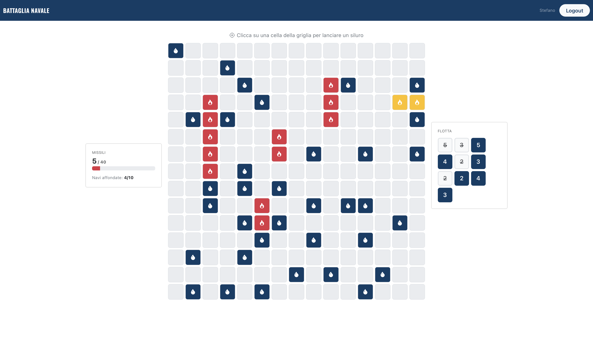

# Battaglia Navale: technical documentation

This document describes the client routes, the REST API, the database schema and the main React components. For an overview and setup instructions, see the [README](../README.md).

## React Client Application Routes

- Route `/`: home page shown to anonymous users, with a short description of the game, the three difficulty cards to start a casual game, and links to login and global statistics. If the user is already authenticated, it redirects to `/dashboard`.
- Route `/login`: login page, contains the login form where users can enter their credentials. Redirects to /dashboard after successful login. Redirects to /dashboard if the user is already authenticated.
- Route `/dashboard`: personal area for authenticated users. Shows options to create a new tournament, join an existing one by entering a code, and a link to the statistics page. Redirects to /login if the user is not authenticated.
- Route `/game/:id`: game screen, shows the NxN grid and allows the player to fire missiles by clicking on cells. Displays the number of missiles remaining, the ships sizes, and the result of each shot. At the end of the game, reveals the positions of all ships. Accessible to both anonymous (casual) and authenticated (tournament) users.
- Route `/stats`: statistics page, shows the number of games played, won and lost, and the win percentage for each difficulty level. Visible to all users, including anonymous ones.
- Route `*`: Default page loaded in case of non-existing URLs.

## API Server

- POST `/api/sessions`
  - request parameters: none
  - request body: credentials (username, password)
  - response body: user info
  - response status: 200 successful login, 401 wrong credentials
  - response body example (in case of success): { id: 1, username: 'stefano@polito.it', name: 'Stefano' }
- GET `/api/sessions/current`
  - request parameters: cookie for passport authentication
  - request body: none
  - response body: user info
  - response status: 200 success, 401 not authenticated
  - response body example (in case of success): { id: 1, username: 'stefano@polito.it', name: 'Stefano' }
- DELETE `/api/sessions/current`
  - request parameters: cookie for passport authentication
  - request body: none
  - response body: none
  - response status: 200 successful logout
- POST `/api/tournaments`
  - request parameters: cookie for passport authentication
  - request body: difficulty (easy, medium, hard)
  - response body: tournament code, id of the newly created game
  - response status: 201 Created, 401 Unauthorized, 422 Unprocessable Entity, 500 Internal Server Error
  - response body example (in case of success): { code: 'CIAO13', gameId: 1 }
- POST `/api/tournaments/:code/join`
  - request parameters: cookie for passport authentication, code (tournament code in the URL)
  - request body: none
  - response body: id of the newly created game
  - response status: 201 Created, 401 Unauthorized, 404 Not Found (tournament code does not exist),409 Conflict (user already has a game in this tournament), 500 Internal Server Error
  - response body example (in case of success): { gameId: 2 }
- POST `/api/games`
  - request parameters: none
  - request body: difficulty (easy, medium, hard)
  - response body: id of the newly created game
  - response status: 201 Created, 403 Forbidden (if user is authenticated), 422 Unprocessable Entity, 500 Internal Server Error
  - response body example (in case of success): { gameId: 1 }
- POST `/api/games/:id/shots`
  - request parameters: game id in the URL, session cookie (the session that created the game for casual games, passport authentication for tournament games)
  - request body: row, col (coordinates of the shot)
  - response body: shot result, updated game status and, when a ship is sunk, the cells of the sunk ship
  - response status: 200 OK, 401 Unauthorized,403 Forbidden (game already ended, or game owned by another user/session), 404 Not Found (game does not exist), 409 Conflict (cell already fired upon), 422 Unprocessable Entity (invalid coordinates), 500 Internal Server Error
  - response body example (in case of success): { result: 'water', missiles: 19, status: 'ongoing', sunkShipCells: null }
- GET `/api/games/:id`
  - request parameters: game id in the URL, session cookie (the session that created the game for casual games, passport authentication for tournament games)
  - request body: none
  - response body: game status, difficulty, missiles remaining, grid size, ship sizes, list of shots fired
  - response status: 200 OK, 401 Unauthorized,403 Forbidden (trying to access another user's or session's game), 404 Not Found (game does not exist), 500 Internal Server Error
  - response body example (in case of success): { status: 'ongoing', difficulty: 'easy', missiles: 19, gridSize: 8, ships: [2, 2, 3, 4], shots: [{ row: 2, col: 3, result: 'water' }, ...] }
- GET `/api/games/:id/ships`
  - request parameters: game id in the URL, session cookie (the session that created the game for casual games, passport authentication for tournament games)
  - request body: none
  - response body: list of all ships with their positions
  - response status: 200 OK, 401 Unauthorized, 403 Forbidden (game still ongoing, or game owned by another user/session), 404 Not Found (game does not exist), 500 Internal Server Error
  - response body example (in case of success): { ships: [{ size: 4, row: 2, col: 3, direction: 'H' }, { size: 2, row: 5, col: 1, direction: 'V' }, ...] }
- GET `/api/config`
  - request parameters: none
  - request body: none
  - response body: game configuration for each difficulty level (grid size, number of ships, available missiles)
  - response status: 200 OK
  - response body example: [{ key: 'easy', gridSize: 8, missiles: 20, shipsCount: 4 }, { key: 'medium', gridSize: 10, missiles: 30, shipsCount: 6 }, { key: 'hard', gridSize: 15, missiles: 40, shipsCount: 10 }]
- GET `/api/stats`
  - request parameters: none
  - request body: none
  - response body: statistics per difficulty level
  - response status: 200 OK, 500 Internal Server Error
  - response body example: { stats: [{ userId: 1, name: 'Stefano', difficulty: 'easy', played: 5, won: 3, lost: 2, winPercentage: 60 }, ...] }

## Database Tables

- Table `users` -  contains id, username, name, hash (hashed password), salt (salt used for hashing the password)
- Table `tournaments` - contains id, code (used to join the tournament), difficulty (easy,medium,hard), grid_size (N of NxN)
- Table `tournament_ships` - contains tournament_id, size (number of cells occupied by the ship), row (starting row of the ship), col (starting column of the ship), direction ('H' for horizontal, 'V' for vertical). Primary key is (tournament_id, row, col). It is copied into ships table when a new player joins
- Table `games` - contains id, user_id (NULL if casual mode), tournament_id (NULL if casual mode), difficulty (easy, medium, hard), grid_size (N of NxN), missiles (number of missiles remaining), status ('ongoing', 'won', 'lost')
- Table `ships` - contains game_id, size, row (starting row of the ship), col (starting column of the ship), direction ('H' for horizontal, 'V' for vertical), sunk (0 if still afloat, 1 if sunk). Primary key is (game_id, row, col).  For tournament games, coordinates are copied from tournament_ships at game creation.
- Table `shots` - contains game_id, row, col (coordinates of the shot), result ('water', 'hit', 'sunk'). Primary key is (game_id, row, col).

## Main React Components

- `MyNavbar` (in `MyNavbar.jsx`): Shows the app brand and, depending on the auth state, either the logged-in user's name with a Logout button or a Login link.
- `Home` (in `Home.jsx`): Landing page for anonymous users. Displays the three difficulty cards and starts a casual game, then navigates to `/game/:id`; also links to login and global statistics.
- `Login` (in `AuthComponents.jsx`): shows a form for inserting credentials (username and password) for login; on submit it validates the inserted data before sending the request to the server.
- `Dashboard` (in `Dashboard.jsx`): Personal area for authenticated users. Greets the user and hosts the `CreateTournament` and `JoinTournament` cards, plus a link to the statistics page.
- `CreateTournament` (in `CreateTournament.jsx`): Lets the user choose a difficulty and create a tournament; shows the generated join code in a modal and starts the creator's game.
- `JoinTournament` (in `JoinTournament.jsx`): Lets the user type a tournament code and join it, then navigates to the newly created game.
- `GameBoard` (in `GameBoard.jsx`): Main game screen for a given game `:id`. Loads the game state, handles firing shots, tracks missiles, sunk ships and status, and at the end fetches and reveals all ship positions.
- `Grid` (in `Grid.jsx`): Renders the NxN grid, deriving each cell's state (empty/water/hit/sunk, plus ship reveal at game end) from the shots and sunk ships, and forwards clicks on valid cells to `GameBoard`.
- `Cell` (in `Cell.jsx`): Component for a single grid cell; renders its color and icon based on the current state and triggers the click handler.
- `ShipIndicator` (in `ShipIndicator.jsx`): Shows the fleet as a set of ship sizes and marks each ship as afloat or sunk.
- `Stats` (in `Stats.jsx`): Statistics page; fetches the global stats and renders a per-difficulty leaderboard (played/won/lost/win %), highlighting the current user if logged in.

## Screenshot

## Users Credentials

- username: stefano@polito.it, password: passwordStefano
- username: marina@polito.it, password: passwordMarina
- username: francesco@polito.it, password: passwordFrancesco

## Use of AI Tools
I used an AI assistant for:
- writing some utility functions in `gameUtils.js`, mainly the random board generation with ship placement (`generateShips`, `canPlaceShip`, `placeShip`);
- debugging;
- a general code review.

I tested and adapted every suggestion before using it: I checked that the generated boards respect the constraints (ship sizes, inside the grid, never adjacent) and that the games are playable, and I kept only the code I understood.